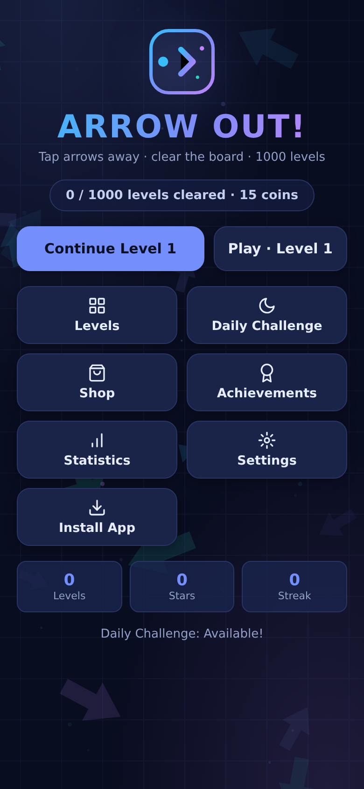
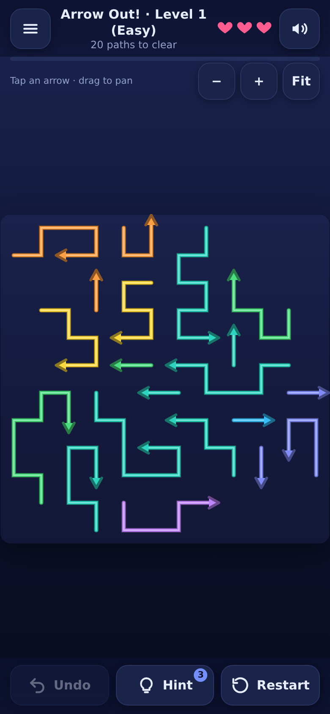

# Arrow Out! 🏹


A mobile-first **tap-away arrow puzzle** game — an **installable PWA**, zero dependencies, fully offline-capable. **1000 levels** of winding arrow paths on boards from 7×7 up to dense 12×12. **3 free hints per level**, hearts, timed bonus objectives, daily challenges, achievements, streaks, skins, stars and synthesized background music.

**🎮 Play now: <https://parya5103.github.io/Fletch_Game/>**

## Screenshots

| Home | In game |
|---|---|
|  |  |

## How to play

- The board is a grid of **winding arrow paths** — each piece is a connected corridor of cells with one arrowhead at its head.
- Tap a piece to launch it: it slides out **like a snake**, following its own path and exiting along the arrowhead's direction.
- A piece can launch **only if its head's exit corridor is clear** — no other piece may sit between the head cell and the board edge along that direction. A blocked tap is a mistake (1 of 3 hearts lost).
- Clear every arrow to win the level. Clear all **1000 levels** to complete the campaign 🏆
- **Undo** reverses your last launch, **Restart** resets the level.
- **Hints:** 3 free per level (a badge on the Hint button counts them down). After that, watch a short demo ad to reveal another hint.

## Difficulty ramp

| Levels | Board | Pieces |
|---|---|---|
| 1–10 | 7×7 → 8×8 onboarding | 7–13 |
| 11–50 | 8×8 → 9×9 easy | up to 20 |
| 51–200 | 9×9 → 10×10 medium | up to 26 |
| 201–500 | 10×10 → 11×11 hard | up to 30 |
| 501–800 | 11×11 → 12×12 expert | up to 34 |
| 801–1000 | **12×12 master** | **up to 36** |

Every piece is a long winding corridor (2–13 cells), so even a 7×7 board is a dense maze. A spike level every 10th adds extra pieces; every 50th level is a distinctive ring layout. Timed bonus objectives appear on levels ending in 5.

## Every level is solvable — guaranteed

Levels are generated by **reverse placement**: pieces are carved one by one onto the board mask, and a piece is only laid down where its winding path can still exit cleanly against the pieces already placed (the exit corridor of its head must stay clear). Reversing that build order always yields a valid clear order, so every level can be finished with zero mistakes, the Hint button can always point to a safe piece, and deadlock states are impossible. All 1000 levels plus the daily challenge are verified solvable with correct hints — and the CI workflow re-verifies this on every push.

## Features

- 💯 **1000 levels** — winding-path boards from 7×7 to dense 12×12, spike levels every 10th, ring milestones every 50th
- 💡 **3 free hints per level**, then a rewarded-ad hint (a clearly-labelled 5-second demo ad runs until a real ad provider is wired into `Ads.provider` — the rewarded flow is ready for AdSense/AdMob H5)
- 🌝 **Daily challenge** — a deterministic puzzle for every date, with streak tracking, plus a home-screen app shortcut that jumps straight into it
- 🎯 **Timed bonus objectives** — clear the golden bonus piece before the countdown ends for extra coins (an expired timer never costs hearts)
- 🎖 **Achievements** — progress-based unlocks, viewable from the home screen
- 📊 **Statistics** — plays, wins, stars, streaks and per-level bests
- 🛍️ **Skins shop** — 11 cosmetic arrow palettes (0–900 coins); coins are only earned by playing, never purchased
- 💾 **Auto-save** — stars, plays and current level save privately on your device; fully offline
- 📱 Mobile-first: touch pointer events, 44px+ action targets, safe-area aware, works from 320px-wide screens
- ⭐ 3-star scoring: ★★★ = no mistakes & no hints · ★★ = ≤2 mistakes & ≤1 hint · ★ = otherwise
- 🗺️ Level map with best stars, locked padlocks and current-level highlight
- 🔊 Synthesized sound effects **and ambient background music** via the Web Audio API — no audio files; separate sound & music toggles
- 📤 **Share buttons** — native share sheet with clipboard fallback (win dialog + main menu)
- 📲 **PWA**: real `manifest.webmanifest` + PNG icons + Daily Challenge app shortcut, service worker (offline-first caching), Android install prompt, iOS Add-to-Home-Screen hint
- 🔔 **Daily reminders**: optional in-Settings toggle (permission is only requested on a deliberate toggle, never on page load) — real Web Push, delivered 4–5 times a day by a scheduled GitHub Actions workflow acting as the free push server; achievement toasts in game
- 🔒 Hardened: Content-Security-Policy meta tag (self-only scripts), zero external requests, no trackers, sanitized save data, hardened service-worker push/click handlers
- 🎨 Dark neon theme with light-mode toggle, color-coded arrows, smooth overlay animations, confetti wins

## Security & privacy (v3.7)

- **Client-side saves**: progress, coins and skins live in your browser's `localStorage`. That is a feature (private, offline, no account) — but it also means a user who edits their own `localStorage` can change their own coins/progress. The game sanitizes saves on load (clamps ranges, drops junk fields, never deletes valid progress), but **localStorage is not cheat-proof and is not meant to be** — there is nothing worth cheating against. Real server-authoritative validation would only become necessary for online leaderboards, purchases or multiplayer, all of which would require a backend this static site deliberately does not have.
- **Notifications are real Web Push with no paid backend**: the push "server" is the scheduled `.github/workflows/notify.yml` workflow (free GitHub Actions cron, 4–5 sends a day in IST). One-time setup: add the `PUSH_VAPID_PRIVATE_KEY` repo secret (pairs with the public key in `js/pwa.js`), then toggle Daily reminders in Settings, copy the subscription code into the `PUSH_SUBSCRIPTIONS` repo secret. The permission prompt only ever fires from the deliberate Settings toggle; toggling off unsubscribes the device. Push payloads and notification-click URLs are re-validated in the service worker (same-origin scope only). If GitHub disables the schedule after 60 days of repo inactivity, re-enable it from the Actions tab.
- **Service worker hardening**: push payloads are untrusted — malformed JSON, wrong types, oversized text and non-local icons are rejected without crashing; notification clicks only open same-origin URLs inside the app scope (`javascript:`, `data:` and external origins are rejected and fall back to the game home screen).
- **CSP**: set via a `<meta>` tag (`script-src 'self'; object-src 'none'; base-uri 'none'`; styles keep `'unsafe-inline'` because the UI uses inline `style` attributes and a critical inline CSS block). Meta-tag CSP cannot express `frame-ancestors`, HSTS, COOP/COEP or `report-only` — those need HTTP response headers, which ordinary GitHub Pages configuration cannot set.
- **Supply chain**: GitHub Actions are pinned to immutable commit SHAs (`actions/checkout`, `actions/setup-node`, `treosh/lighthouse-ci-action`) and run with least-privilege permissions. The CI job is read-only (`contents: read`); only the screenshot/icon jobs that must commit back get `contents: write`.

## Project structure

| Path | Purpose |
|---|---|
| `index.html` | App shell — markup, inline critical CSS, dialog overlays |
| `about.html` | About the game + how-to-play text page (SEO / ad-review ready) |
| `privacy.html` | Privacy policy page (what the game stores, notification data, deletion) |
| `css/styles.css` | Full stylesheet |
| `js/game.js` | Game core: board logic, level generation, validation (`GameCore`) |
| `js/render.js` | Canvas board renderer + animations |
| `js/audio.js` | Web Audio SFX + ambient music (no audio files) |
| `js/haptics.js` | Vibration feedback |
| `js/storage.js` | Save-data layer (localStorage) |
| `js/ui.js` | Dialogs, HUD, level map, toasts |
| `js/main.js` | Game flow: init, input, win/fail, ads, share |
| `js/pwa.js` | Service-worker registration + install prompts |
| `sw.js` | Service worker — offline caching (versioned cache) |
| `manifest.webmanifest` | PWA manifest |
| `icons/` | PNG icons (192/512/maskable) + SVG favicon, generated by Actions |
| `scripts/gen-icons.js` | Pure-Node PNG icon generator (no deps) |
| `scripts/ci-test.js` | CI smoke tests: generator solvability, determinism, star rules |
| `scripts/screenshot.js` | Puppeteer screenshot generator for `docs/` |
| `.github/workflows/ci.yml` | Syntax checks + game-logic tests on every push/PR |
| `.github/workflows/gen-icons.yml` | Regenerates PNG icons when the generator changes |
| `.github/workflows/screenshot.yml` | Refreshes `docs/` screenshots when the UI changes |
| `.github/workflows/lighthouse.yml` | Advisory Lighthouse run against the live site |
| `LICENSE` | MIT license |

## Run locally

Just open `index.html` in a browser, or serve the folder over HTTP so the service worker can register:

```bash
npx http-server .
# or
python3 -m http.server 8000
```

Run the CI smoke tests locally:

```bash
node scripts/ci-test.js
```

## Deploy on GitHub Pages

1. Repo → **Settings → Pages** → Source: **Deploy from a branch** → Branch: `main` / `/(root)` → Save.
2. Open `https://<your-user>.github.io/<repo>/` — install it from the in-game Install button (Android/Chrome) or Share → Add to Home Screen (iOS Safari).

## Recent changes

- **v3.9** (2026-10-16): launch content — new `privacy.html` (plain-language privacy policy: localStorage-only saves, notification data handling, how to delete) and `about.html` (about, full how-to-play, FAQ) static pages, linked from Settings and the How-to-play dialog; SW v27 (both pages precached for offline).
- **v3.8** (2026-10-16): real daily reminders — Settings test button replaced by a Daily-reminders Web Push subscription (4–5 notifications a day sent by a free scheduled GitHub Actions workflow; one-time repo-secret setup, instructions in the in-game dialog and README), service worker v26, shop upgraded to 11 skins (4 new: Ember Glow, Ice Frost, Cyber Neon, Mono Slate with NEW badges), skins sanity checks in CI.
- **v3.7** (2026-10-16): security pass — save-data sanitizer (corrupt or hand-edited `localStorage` can no longer break boot or stats; valid progress never deleted), deep-merge crash guard, achievement toasts, optional notifications (toggle + permission state + test button, local-only, no server push), hardened SW push/notificationclick (payload validation + same-origin click URLs), DOM-safe achievements grid, SHA-pinned least-privilege workflows, new CI test suites for save validation/economy and SW payload/URL validation; SW v25.
- **v3.6** (2026-10-16): fixed double-counted play stats (per-level `plays` and `totalPlays` showed 2× on the stats page); daily wins now count toward win achievements; PWA app shortcut deep link (`?daily=1`); Content-Security-Policy meta tag; SW v24.
- **v3.5**: exit rule fixed to head-corridor-only — winding body projections no longer false-block a launch (2473 freed exits across levels 1–1000).
- **v3.3**: a failed level's snapshot is no longer resurrected by the auto-save.

## Roadmap

- Real ad provider integration (rewarded hints are already wired; policy pages shipped in v3.9)
- Supabase-backed push subscription collection (players auto-submit, no copy-paste)
- Custom domain
- Play Store release (TWA — the PWA is already install-ready)
- Cloud save sync

## License

MIT © 2026 Pratik Arya
